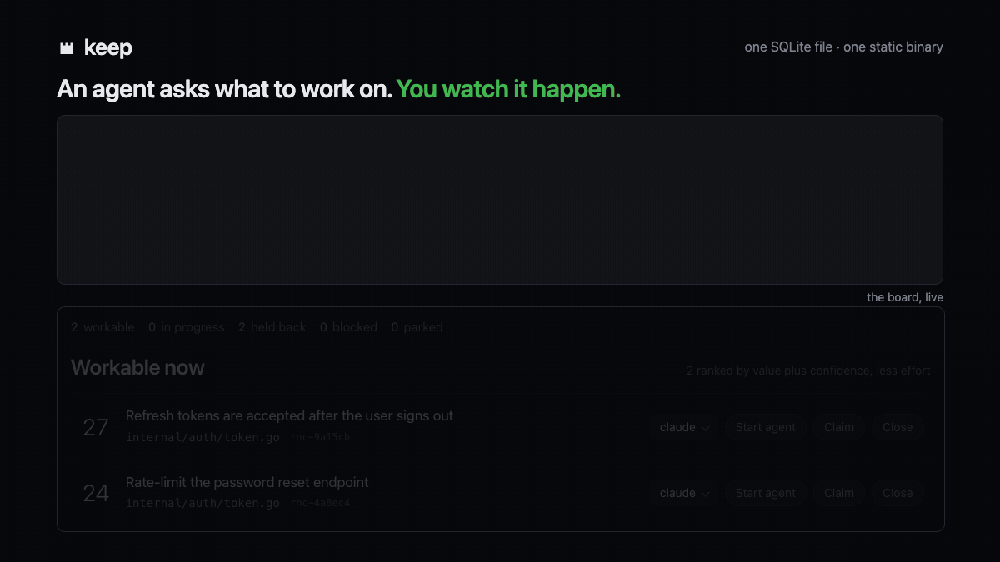
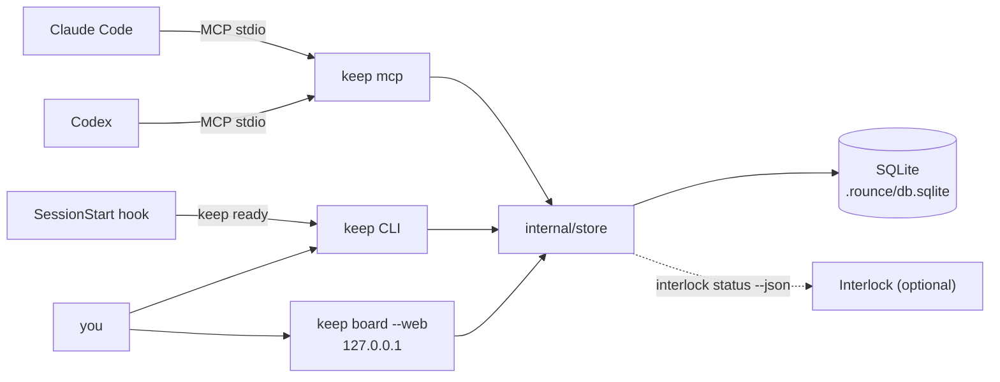

# keep

A local work queue for AI coding agents: tickets, backlog and a dependency graph in one SQLite file, served to Claude Code and Codex over MCP.




When several agents work in one repository, they need to agree on what to do
next. A chat transcript or a `TODO.md` doesn't give them that. keep gives
every agent the same queue. Claude Code and Codex sessions file items, ask for
the ranked list of what is workable, claim one item atomically, and close it
with a reason. Everything lives in a single SQLite file in the repository. You
look at the board when you want to. keep never calls a model and never makes
a network request. It stores the decisions, and agents do the reasoning.

## Features

- **One shared queue.** Items, a typed dependency graph, a ranked `ready`
  list and per-session claims, all in `.rounce/db.sqlite`. Claude Code, Codex
  and the CLI all read and write the same file.
- **Blocking that reaches the whole tree.** Block an epic and every item
  beneath it leaves `ready`, at any depth. The rule lives inside one SQL view,
  so the CLI, MCP and the dashboard can't disagree about it.
- **Atomic claiming.** `keep next` picks the top item and claims it in one
  transaction, so ten agents calling it at once get ten different items.
- **MCP server with 20 tools.** `keep mcp` serves the queue over stdio. Each
  tool makes exactly one store call, and a test that walks the AST enforces
  that.
- **Claude Code and Codex plugins.** A `SessionStart` hook puts the ranked
  queue into the agent's context before your first message. The plugins also
  add `/keep:ready`, `/keep:board` and `/keep:file`.
- **Loopback dashboard.** `keep board --web` serves a board, a tree view,
  search and activity on 127.0.0.1. It has no JavaScript and loads no
  external assets.
- **File-aware with Interlock.** If you also install
  [Interlock](https://github.com/gshepptech/interlock), keep stops offering
  work whose files another agent is editing.

## Quick start

You need Go 1.25 or newer.

```bash
go install github.com/gshepptech/keep/cmd/keep@latest

cd ~/your-repo
keep init                     # creates .rounce/db.sqlite
```

File an item and ask for the queue:

```console
$ keep add --score 9/8/2 "Expire refresh tokens after 30 days"
rnc-7cf193

$ keep ready
rnc-7cf193  26  task  Expire refresh tokens after 30 days
```

`--score` takes value/confidence/effort, each from 0 to 10. Unscored items
still appear in `ready`, sorted last.

Next, give the queue to your agents. With Claude Code:

```bash
claude mcp add keep -- keep mcp
```

With Codex:

```bash
codex mcp add keep -- keep mcp
```

For the session hook and slash commands, install the plugin instead. See
[plugin/README.md](plugin/README.md).

After that, talk to the agent in plain language:

| you say | the agent calls |
|---|---|
| "scout this repo and file what's worth fixing" | `capture`, `add` |
| "what should I pick up?" | `ready` |
| "take the top one" | `next` |
| "done, merged in #42" | `close` with a reason |
| "park that for now" | `capture` (it goes to the backlog) |

## How it works



- **One core, three surfaces.** The CLI (`cmd/keep`), the MCP server
  (`internal/mcp`) and the dashboard (`internal/dash`) are thin wrappers over
  `internal/store`. That package holds all the SQL, and a boundary test fails
  the build if SQL appears anywhere else.
- **The queue is a view.** `ready` is a recursive SQL view. It drops raw
  items, closed items and anything with an open `blocks` edge on itself or an
  ancestor. No caller can forget to apply the filter.
- **Raw versus ticket.** `capture` stores a note or document exactly as given,
  at stage `raw`, which never appears in `ready`. An agent refines it into
  tickets with `add --parent <id> --derived-from <id>`, which records where
  each ticket sits in the tree and where it came from as two separate edges.
- **Append-only events.** Every mutation writes one event row recording the
  actor, the session and, for `close` or `drop`, the reason. `keep log` and the
  dashboard's activity page read it.
- **Agents are identified by session.** `KEEP_SESSION` and `KEEP_ACTOR` are
  read once when the MCP server starts. If `KEEP_ACTOR` is unset, the actor
  comes from the client name in the MCP handshake, so Codex and Claude Code
  record their own names automatically.
- **No Go import between keep and Interlock.** Each program reads the other's
  versioned `--json` CLI output, and each works alone.

The blocking rule, step by step:



```console
$ keep dep rnc-4ff9e2 blocks rnc-2f5770     # the epic waits on the bug

$ keep ready
rnc-2f5770    24  bug   Retry drops last error

$ keep blocked
rnc-4ff9e2.1  26  task  High value child ← blocked by rnc-4ff9e2
rnc-4ff9e2    20  epic  Ship the store   ← blocked by rnc-2f5770
rnc-4ff9e2.2  16  task  Low value child  ← blocked by rnc-4ff9e2
```

## Usage

The CLI has 27 commands, and every read command takes `--json`. The most
common ones:

| Command | What it does |
|---|---|
| `add <title>` | Create a ticket (`--parent`, `--blocks`, `--score`, `--why`, `--paths`) |
| `capture <title>` | Store a raw note or document (`--body -` reads stdin) |
| `ready` / `blocked` / `backlog` | The workable queue, what is held back, what is parked |
| `next` | Claim the top workable item in one step |
| `start` / `close` / `drop` / `unclaim` / `reopen` | Move an item through its life; the last four need `--reason` |
| `why-not <id>` | Explain why an item is not in `ready` |
| `search` / `log` / `stale` | Find items, read the event log, find claims that went quiet |
| `ready --all` / `repos` | One queue across every repository on this machine |
| `board [--web]` | Terminal summary, or the loopback dashboard |
| `export` / `import` / `migrate` | JSONL backup and restore, schema upgrades |

The store is found by `--db`, then `$KEEP_DB`, then the nearest
`.rounce/db.sqlite` above the current directory, then `~/.rounce/db.sqlite`.

More documentation:

- [docs/guide.md](docs/guide.md): a walkthrough and the full command reference
- [docs/agents.md](docs/agents.md): MCP registration, the 20 tools, and what to put in `CLAUDE.md`
- [docs/concepts.md](docs/concepts.md): the data model and the reasons behind it
- [docs/interlock.md](docs/interlock.md): running keep and Interlock together
- [plugin/README.md](plugin/README.md): the Claude Code and Codex plugins

## Development

```bash
go build ./...
go vet ./...
go test ./...
scripts/coverage.sh       # coverage, including the built binary
```

The SQLite driver is `modernc.org/sqlite`, which is pure Go, so builds need no
cgo. Most CLI tests run a real built binary against a temporary store. The
Interlock integration test builds Interlock from `$INTERLOCK_SRC` (or
`~/Projects/interlock`) and skips when neither exists. See [CONTRIBUTING.md](CONTRIBUTING.md).

## Prior art

The `ready` design, where blocking propagates down a parent-child tree, is
taken from [Beads](https://github.com/steveyegge/beads), along with typed
dependency edges and hierarchical ids. No Beads code is used. The design was
read and reimplemented.

## License

MIT. See [LICENSE](LICENSE).
