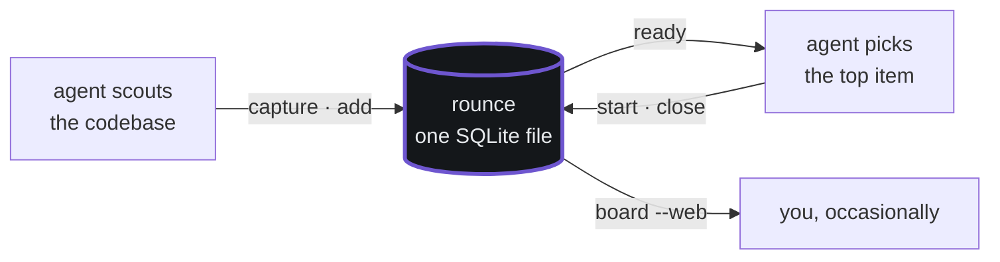
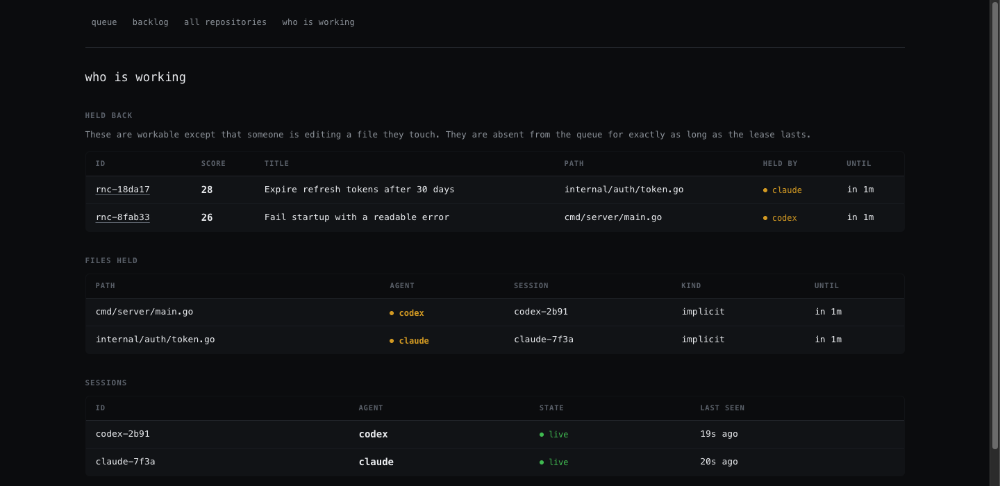

<div align="center">

```
 ██▀███   ▒█████   █    ██  ███▄    █  ▄████▄  ▓█████
▓██ ▒ ██▒▒██▒  ██▒ ██  ▓██▒ ██ ▀█   █ ▒██▀ ▀█  ▓█   ▀
▓██ ░▄█ ▒▒██░  ██▒▓██  ▒██░▓██  ▀█ ██▒▒▓█    ▄ ▒███
▒██▀▀█▄  ▒██   ██░▓▓█  ░██░▓██▒  ▐▌██▒▒▓▓▄ ▄██▒▒▓█  ▄
░██▓ ▒██▒░ ████▓▒░▒▒█████▓ ▒██░   ▓██░▒ ▓███▀ ░░▒████▒
░ ▒▓ ░▒▓░░ ▒░▒░▒░ ░▒▓▒ ▒ ▒ ░ ▒░   ▒ ▒ ░ ░▒ ▒  ░░░ ▒░ ░
```

### the place work lives for AI coding agents

Tickets, backlog, roadmaps, and a dependency graph —
in **one SQLite file** and **one static binary**.

<br>


**`no account`** · **`no server`** · **`no SaaS`** · **`no JavaScript`** · **`no telemetry`**

<br>


</div>

---

## The one thing it does that nothing else does

Block an epic. **Its entire subtree leaves the queue.**

```console
$ rounce ready
rnc-d0b096.1  26  task  High value child
rnc-28b866    24  bug   Retry drops last error
rnc-d0b096    21  epic  Ship the store
rnc-d0b096.2  13  task  Low value child

$ rounce dep rnc-d0b096 blocks rnc-28b866      # the epic waits on the bug

$ rounce ready
rnc-28b866    24  bug   Retry drops last error      ← everything else is gone

$ rounce blocked
rnc-d0b096.1  26  task  High value child ← blocked by rnc-d0b096
rnc-d0b096    21  epic  Ship the store   ← blocked by rnc-28b866
rnc-d0b096.2  13  task  Low value child  ← blocked by rnc-d0b096
```

That propagation lives **inside the SQL view**, not in a caller. No surface can
forget to apply it, and every surface — CLI, MCP, dashboard — is provably
reading the same query.

---

## The loop

You are not meant to type `rounce` all day. **Agents are.**



> **rounce never calls a model.** It is a store. Refinement, triage, and
> estimation are things an agent does *using* rounce — which is exactly why any
> agent, any plugin, any editor works with it.

---

## Quickstart

```bash
git clone git@github.com:gshepptech/rounce.git
cd rounce && go install ./cmd/rounce      # → $(go env GOPATH)/bin/rounce

cd ~/Projects/your-repo
rounce init                               # → .rounce/db.sqlite
```

<sub>Private repository, so `go install …@latest` needs
<code>GOPRIVATE=github.com/gshepptech/*</code> and git credentials. Cloning is
simpler.</sub>

**Give your agents the tools:**

```bash
claude mcp add rounce -e ROUNCE_ACTOR="$USER" -- rounce mcp
```

Then just talk to them:

| you say | the agent calls |
|---|---|
| *"scout this repo and file what's worth fixing"* | `capture` · `add` |
| *"what should I pick up?"* | `ready` |
| *"take the top one"* | `start` |
| *"done — merged in #42"* | `close --reason` |
| *"park that, not yet"* | `capture` → the backlog |

---

## Four surfaces, one store

<table>
<tr>
<td width="25%" align="center"><h3>CLI</h3>13 verbs<br/><code>--json</code> on every read</td>
<td width="25%" align="center"><h3>MCP</h3>10 tools over stdio<br/>zero logic of its own</td>
<td width="25%" align="center"><h3>Dashboard</h3>loopback only<br/>no JS, no assets</td>
<td width="25%" align="center"><h3>Registry</h3>every repo<br/>on one board</td>
</tr>
</table>

```console
$ rounce board
ready 3   in progress 0   blocked 0   backlog 1

rnc-6b813d.1  26  task  Wire the tree view
rnc-6b813d    23  epic  Ship the dashboard
rnc-8746bb    22  bug   Fix the flake

$ rounce board --web
http://127.0.0.1:63688
```

<details>
<summary><b>Cross-repo — one queue over everything you are working on</b></summary>

<br>

```console
$ rounce ready --all
rounce      rnc-0a4518  26  task  Wire the tree view
interlock   rnc-fc4427  23  task  Lease renewal backoff     ← different repository
rounce      rnc-e80b39  14  task  Tidy the flag help

$ rounce repos
rounce      41  187  2026-08-12T01:47:51Z  /Users/you/Projects/rounce/.rounce/db.sqlite
interlock   12   64  2026-08-11T18:02:11Z  /Users/you/Projects/interlock/.rounce/db.sqlite
old-thing   error: store not found (deleted or moved): …
```

A deleted store **reports on its row and is skipped** — never a crash, never a
failed render for the others. Stores open read-only, so a missing one fails
cleanly instead of being silently recreated as an empty database.

</details>

<details>
<summary><b>Capture a document verbatim, refine it into tickets later</b></summary>

<br>

```console
$ rounce capture "Q3 roadmap" --type roadmap --body - < ROADMAP.md
rnc-5d5874

$ rounce show rnc-5d5874 --body | diff - ROADMAP.md
                                       # silent — byte-identical, 11,874 bytes

$ rounce ready                         # the roadmap never appears here
$ rounce backlog                       # it waits in the pen until refined
```

Refinement is not a command. An agent reads `show` and issues
`add --parent … --derived-from …`, which records **structure** and **history**
as two separate edges. Six weeks later, *"why does this ticket exist"* still has
an answer.

</details>

---

## Two agents, one queue

Install [Interlock](https://github.com/gshepptech/interlock) alongside rounce
and the queue stops offering work another agent is already editing.

Neither program imports the other. Each reads the other over a versioned CLI
contract, and each works completely alone — a Go import would have made that a
slogan instead of a fact.



Two items are held back. The page names who holds them and until when; the
queue omits exactly those two. The board and this page share one filter, so the
board can never drop an item this page fails to explain.


The same moment from Interlock's side. **Next** is rounce's queue, already
filtered. **Files held**, below it, is why the two higher-scoring items are not
in it.

```bash
rounce add --paths "internal/auth/token.go" --score 9/9/1 "Expire refresh tokens"
```

`paths` is the whole join. An item that declares none is never held back —
rounce would rather offer work someone has quietly started than hide work
nobody is doing.

**[Full guide →](docs/interlock.md)**

---

## Principles

1. **rounce never calls a model.** It is a store. Refinement, triage, and
   estimation are things an agent does *using* rounce. This is why any plugin
   or any agent works with it, and why the binary stays small.
2. **One core, three surfaces.** The CLI, the MCP server, and the dashboard are
   thin wrappers over `internal/store`. No surface carries behaviour of its own
   — enforced by an AST test, not by discipline.
3. **A new concept gets a new table, never a new column on `items`.** Beads'
   `issues` type reached roughly five dozen fields by absorbing an event bus and
   a scheduler. An escape-hatch JSON column does not prevent this and has been
   observed not to.
4. **Raw is not workable.** Parking an item has to actually remove it from the
   work queue, or "not yet" means nothing. Enforced in the view, not in callers.
5. **Local and private by default.** The dashboard binds to loopback, fetches
   no external assets, and ships no JavaScript — asserted over *rendered*
   output, because `html/template` does not enforce same-host on its own.
6. **Correct before fast.** Materialize a computed column only after measuring
   that the query is too slow, not in anticipation.

---

## What rounce is not, as of 2026-08-12

> This list exists because every item on it will one day arrive as a reasonable
> ten-minute change. Adding one is a decision to be made deliberately and dated
> here, not a patch.

| | why |
|---|---|
| **No multi-machine sync** | No JSONL export, no Dolt, no CRDT, no merge resolution. Sharing a store means sharing a repository |
| **No external tracker bridges** | No Jira, Linear, GitHub Issues, GitLab, Azure DevOps, or Notion. `items.external_ref` is a string nobody reads |
| **No HTTP API** | Beyond the loopback dashboard. No federation, no remote |
| **No orchestration primitives in `items`** | No awaits, timeouts, waiters, agent state, or roles. Coordination belongs in Interlock, which observes agents deterministically through hooks — rounce says *what needs doing*, Interlock says *who is doing what and where* |
| **No model calls** | No embeddings, no semantic search |
| **No migration framework** | Beyond a `schema_version` integer, until there is data worth not breaking |

---

## Built the hard way

<div align="center">

| | |
|---|---|
| **59** requirements | every one closed with named evidence |
| **6** phases | each with a machine-checkable exit gate |
| **220** demo checks | run against a real built binary |
| **225** tests | every one deliberately broken once to prove it fails |
| **2** runtime dependencies | `modernc.org/sqlite`, `modelcontextprotocol/go-sdk` |
| **0** cgo | `go build` gives you one static file |

</div>

Every test here was broken on purpose and confirmed to fail before it was
believed. That discipline caught, among other things: an AST scan that would
have reported **zero** mutating methods while appearing to enforce a rule, a
tree query that silently returned one row instead of erroring, and a demo
assertion whose `awk` could never fail.

---

## Prior art

The `ready` query design — dependency blocking that propagates down a
parent-child tree, so blocking an epic hides its whole subtree — is taken from
[**Beads**](https://github.com/steveyegge/beads) (MIT, Copyright © 2025 Beads
Contributors), as is the idea of typed dependency edges and recording where a
discovered item came from. **No Beads code is used**; the design was read and
reimplemented.

The item scoring model (`value` / `confidence` / `effort` → `score`) and the
convention that an item's rationale cites `file:line` are derived from the
**Ranger** plugin in `the-tavern`, which scores on four factors, not three:
rounce has no `consequence` term, and puts effort on a 0-10 scale rather than
Hollis's 0-5.

---

<div align="center">

**[Roadmap](ROADMAP.md)** · **[Design docs](docs/design/)** · **[Data model](ROADMAP.md#data-model)**

<sub>All rights reserved.</sub>

</div>
