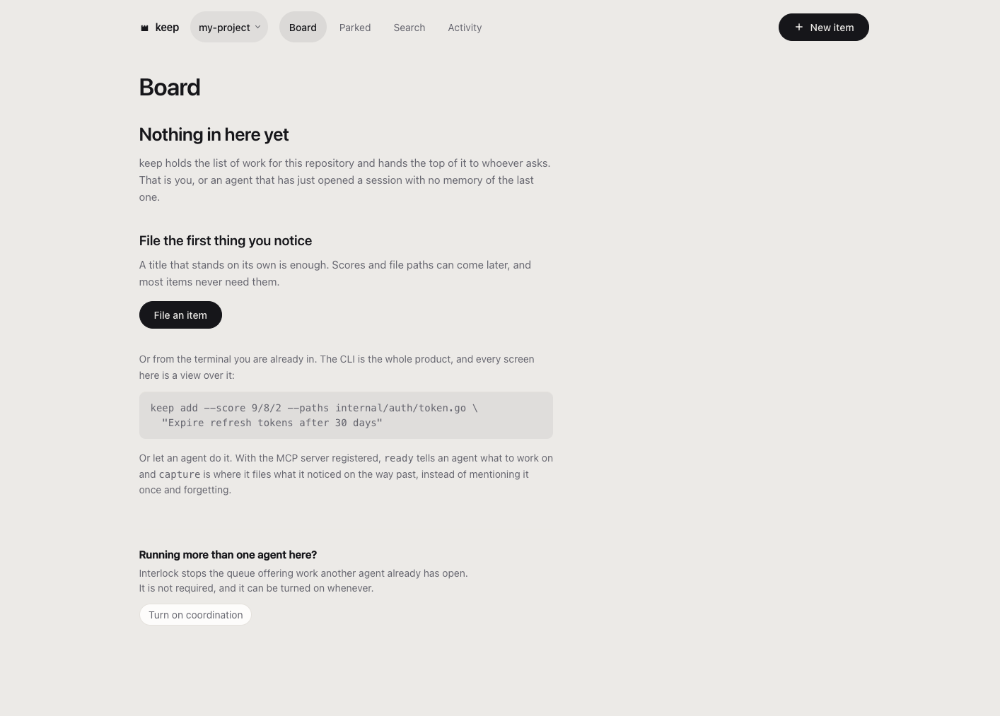
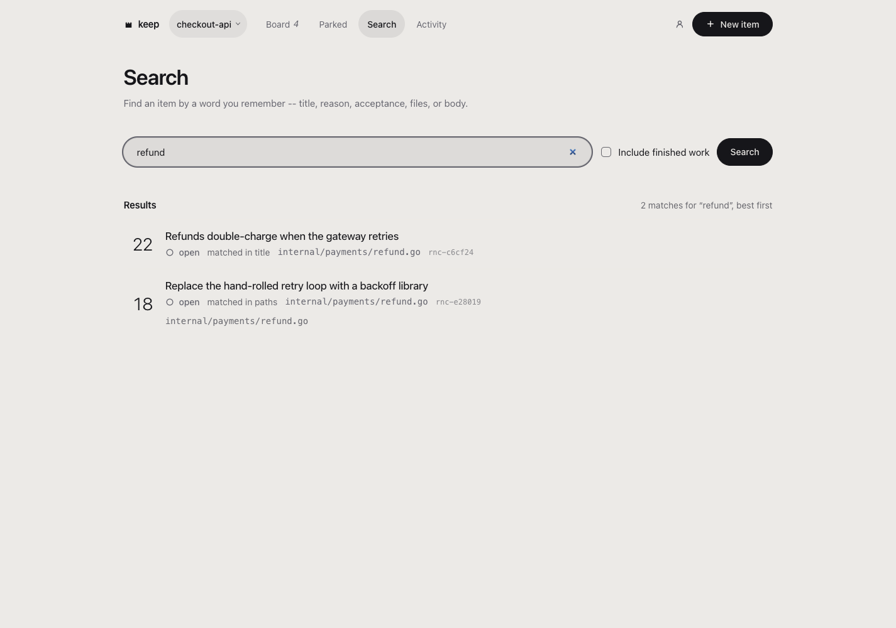
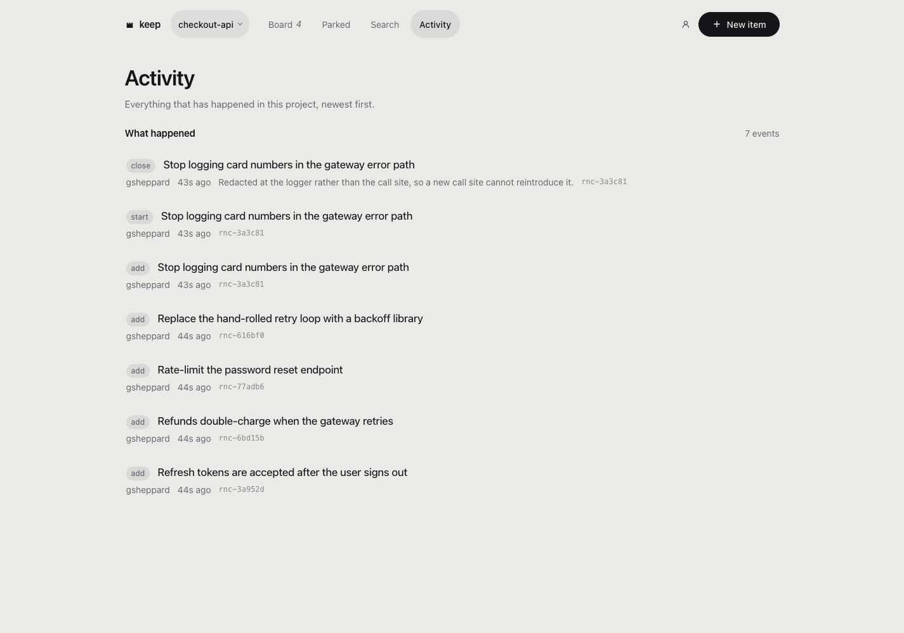
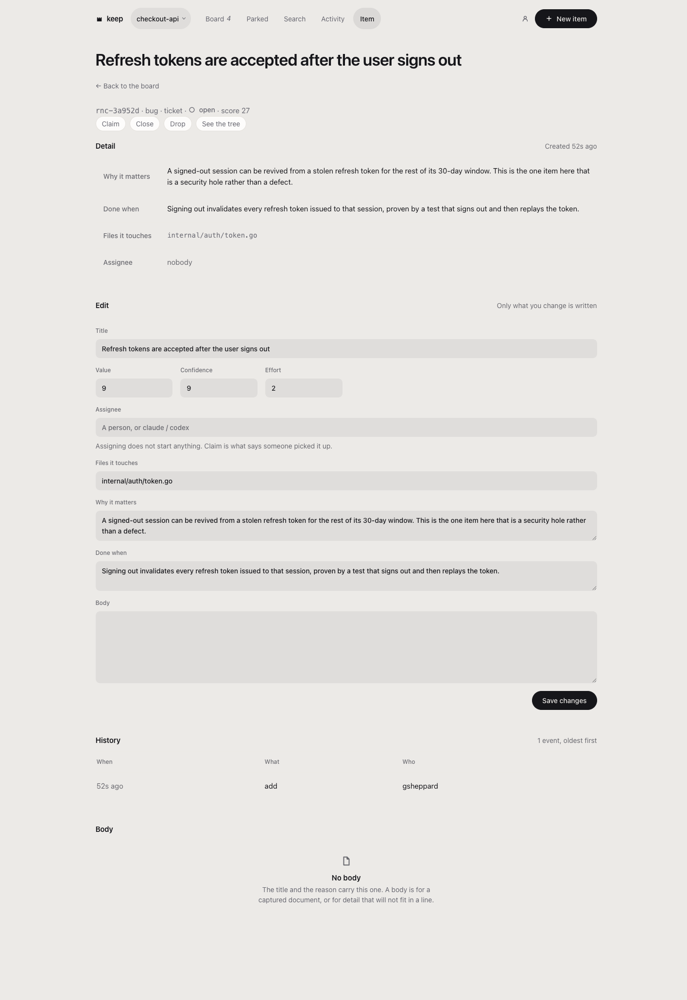

# The keep guide

## What keep is

keep is a to-do list that AI coding agents read and write. It stores
tickets, a backlog, and a dependency graph in one SQLite file per repository,
and it never calls a model — it's a store, nothing more. Refinement, triage,
and scoring are things an agent does *using* keep's commands; keep itself
just remembers what got decided.

You mostly won't type `keep` yourself. The loop is: an agent scouts a
repository and files what it finds (`capture`, `add`), asks `ready` what's
workable, `start`s the top item, and `close`s it with a reason when it's
done. You show up occasionally to look at the board, block something that
shouldn't be worked on yet, or point a fresh agent at the queue.

**What it is not:** it's not a tracker with sync (no Jira/Linear/GitHub
Issues bridge, no cross-machine merge — see `docs/concepts.md`'s "deliberate
refusals"), it's not an orchestrator (it doesn't know which agent is doing
what right now — that's a different tool's job), and it doesn't parse
anything itself. If a document needs turning into tickets, an agent reads it
and issues `add` commands; keep never touches a model to do that for you.

For the reasoning behind specific decisions, `docs/concepts.md` has the full
argument with citations to the design docs. This guide is the walkthrough.

## A five-minute first session

```console
$ keep init
/Users/you/Projects/demo/.rounce/db.sqlite
```

That's it for setup — one SQLite file under `.rounce/` in the current
repository. Running `init` again is a no-op (it prints `unchanged: <path>`
and destroys nothing); `keep init --global` instead writes
`~/.rounce/db.sqlite`, for anyone who'd rather have one store for everything.

Add a few items. `add` prints the new item's id and nothing else, which is
what makes `id=$(keep add ...)` work in a shell:

```console
$ keep add --type bug --score 8/6/2 "Fix flaky auth test"
rnc-a91f3c

$ keep add --type task --score 5/6/4 "Write onboarding doc"
rnc-72e0b5

$ keep add --type epic --score 6/5/6 "Support dark mode"
rnc-1cd8f2
```

`--score` is `value/confidence/effort`, each 0-10 — more on what the number
means below. Now ask what's workable:

```console
$ keep ready
rnc-a91f3c  23  bug   Fix flaky auth test
rnc-72e0b5  18  task  Write onboarding doc
rnc-1cd8f2  16  epic  Support dark mode
```

Highest score first. Claim one and finish it:

```console
$ keep start rnc-a91f3c
rnc-a91f3c claimed by session ""

$ keep ready
rnc-72e0b5  18  task  Write onboarding doc
rnc-1cd8f2  16  epic  Support dark mode

$ keep close rnc-a91f3c --reason "fixed the race in TestAuthRetry"
rnc-a91f3c closed
```

`start` set the item's status to `in_progress`, which is enough on its own to
drop it out of `ready` — you don't need to close something to stop seeing it
as workable. The empty session id (`claimed by session ""`) is normal here:
`start` records whatever `$KEEP_SESSION` is set to, and a human typing
commands directly usually hasn't set it. Agents running through MCP do —
`docs/agents.md` covers that.

Notice `close` needed `--reason`. There's a separate `drop` command for
abandoned work, with the identical shape:

```console
$ keep drop rnc-1cd8f2 --reason "dark mode is now covered by rnc-9c02af"
rnc-1cd8f2 dropped
```

`close` and `drop` are two different commands rather than one `--status`
flag, specifically so "did this get done" and "was this abandoned" can never
be confused later by something that only checked a status enum. Same
reasoning is why `update` (which changes title/body/score/type/... on an
existing item) has no `--status` flag at all — status only ever moves through
`start`/`close`/`drop`, each of which is on the hook to say why.

One more thing worth knowing early: flags can go on either side of the
positional argument. `keep show rnc-a91f3c --json` and
`keep show --json rnc-a91f3c` both work — a pre-pass reorders arguments
before the flag parser ever sees them, which is also what makes
`keep capture "title" --type roadmap --body -` work even though the title
comes first.

## The blocking demo

This is the one idea worth understanding before anything else: **blocking
propagates down the tree.** Block an epic and every ticket beneath it, at any
depth, disappears from `ready` — not dimmed, not deprioritized, gone, so an
agent asking "what's workable?" cannot pick any of it up. This is enforced
inside the `ready` SQL view itself, not by any caller remembering to check —
see `docs/concepts.md` for exactly how.

Start with an epic and two children:

```console
$ keep ready
rnc-4e47ef.1  27  task  High value child
rnc-df86a0    25  bug   Retry drops last error
rnc-4e47ef    23  epic  Ship the store
rnc-4e47ef.2  14  task  Low value child
```

Four workable items: the epic (`rnc-4e47ef`), its two children
(`rnc-4e47ef.1`, `rnc-4e47ef.2` — the parent's hash is visible in the child's
own id), and an unrelated bug (`rnc-df86a0`). Now block the epic on that bug:

```console
$ keep dep rnc-4e47ef blocks rnc-df86a0
rnc-4e47ef blocks rnc-df86a0
```

Read that direction carefully — `dep A blocks B` means **A waits on B**, not
the reverse. Ask what's ready now:

```console
$ keep ready
rnc-df86a0  25  bug  Retry drops last error
```

The epic and both children are gone. Not just the epic — both of its
children too, even though neither one has a `blocks` edge of its own. Check
`blocked` to see why, and who each item blames:

```console
$ keep blocked
rnc-4e47ef.1  27  task  High value child ← blocked by rnc-4e47ef
rnc-4e47ef    23  epic  Ship the store   ← blocked by rnc-df86a0
rnc-4e47ef.2  14  task  Low value child  ← blocked by rnc-4e47ef
```

The epic names the bug directly — that's the real blocker. Both children name
the epic, not the bug: `blocked` always names the *nearest* blocked ancestor,
which is what you actually want to look at first when you're untangling why
something isn't workable. A grandchild three levels down would still name its
immediate blocked parent, not the root cause, and you'd walk up from there.

Close the bug and everything comes back:

```console
$ keep close rnc-df86a0 --reason "fixed the retry loop"
rnc-df86a0 closed

$ keep ready
rnc-4e47ef.1  27  task  High value child
rnc-4e47ef    23  epic  Ship the store
rnc-4e47ef.2  14  task  Low value child
```

The epic and both children are back — `rnc-df86a0` itself is gone now
instead, because closing it took it out of `ready` the ordinary way (`ready`
only shows `status = open`). Closing the one thing blocking the epic
instantly restores the whole subtree, at whatever depth it goes, with no
command touching the children directly.

This is also the reason a raw roadmap document is safe to park mid-refinement:
if you `capture` a document and haven't refined any tickets from it yet,
nothing is blocked and nothing is hidden — there's simply nothing in `ready`
to hide, because raw items were never there to begin with. Which is the next
topic.

## Capture and refine

Two things live in the store: `raw` items (captured, not workable) and
`ticket` items (refined, ranked, pickable). `ready` only ever shows tickets —
`stage = 'ticket'` is baked into the view. A captured document just sits
there until something promotes it.

Pipe a real document in:

```console
$ keep capture "Q3 roadmap" --type roadmap --body - < ROADMAP.md
rnc-8f2c91
```

`--body -` reads stdin. The body is stored byte-for-byte — `show --body`
returns exactly what went in, which matters because an agent refining it
needs the actual document, not a reformatting of it:

```console
$ keep show rnc-8f2c91 --body | diff - ROADMAP.md
                                       # silent — no output means identical
```

It never shows up in `ready`, and it sits in the backlog instead:

```console
$ keep ready
                                       # nothing — the roadmap is raw
$ keep backlog
roadmap
rnc-8f2c91  2026-08-12  Q3 roadmap
```

Backlog output has no score column, on purpose — a raw item hasn't been
scored yet, and won't be until it's refined. Items are grouped by type, newest
first within each group.

There is deliberately no `refine` command. An agent reads the document and
issues an ordinary `add`, with two flags that mean two different things:

```console
$ keep add --parent rnc-8f2c91 --derived-from rnc-8f2c91 \
    --score 8/7/3 --why "removes duplicate config parsing across three services" \
    "Extract the shared config loader"
rnc-8f2c91.1

$ keep ready
rnc-8f2c91.1  23  task  Extract the shared config loader
```

`--parent` puts the new ticket in the tree, so blocking the roadmap (or an
epic above it) reaches this ticket too. `--derived-from` records where the
ticket's content actually came from. They're usually the same id — as they
are here — but they don't have to be: a ticket can be parented under one
epic while its content was refined out of an entirely different parked note.
That's why they're two separate edges rather than one flag.

**Why this matters six weeks later:** the roadmap document is still sitting
in the backlog, unchanged, and `keep show rnc-8f2c91.1` still resolves a
`derived-from` edge back to it. When someone asks "why does this ticket
exist," the answer doesn't depend on anyone remembering the session that
created it — it's a fact in the store. In a backlog that fills itself from
agent scouting, that's the difference between a queue you can trust and one
you eventually have to delete and re-scout from scratch.

There's a second, simpler promotion path for a single parked note that
doesn't need a new child item — `update --stage ticket` promotes the same
item in place:

```console
$ keep capture "Rate limiter is per-process, should be shared"
rnc-b31a04

$ keep backlog --type note
note
rnc-b31a04  2026-08-12  Rate limiter is per-process, should be shared

$ keep update --stage ticket --score 8/8/2 rnc-b31a04
rnc-b31a04 updated

$ keep backlog --type note
                                       # empty — it's a ticket now

$ keep ready
rnc-b31a04    25  note  Rate limiter is per-process, should be shared
rnc-8f2c91.1  23  task  Extract the shared config loader
```

No new id, no `derived-from` edge — there's nothing to derive from, it's
still the same item, just relabeled. Use this when a parked note turns out
to just *be* the ticket; use `add --parent ... --derived-from ...` when a
document spawns tickets that should outlive it.

## Scoring

`score` is computed from three inputs, each 0-10:

```
score = value + confidence - effort + 11
```

The `+11` exists so every *scored* item lands at 1 or above, and an
*unscored* item — one where `value`, `confidence`, and `effort` were never
set — gets exactly `0`. Zero always sorts last, but it is never excluded from
`ready`:

```console
$ keep add --type task "Investigate slow CI on Windows runners"
rnc-c47a10

$ keep ready
rnc-b31a04    25  note  Rate limiter is per-process, should be shared
rnc-8f2c91.1  23  task  Extract the shared config loader
rnc-c47a10     0  task  Investigate slow CI on Windows runners
```

That last item has no `--score` at all, and it's still right there at the
bottom of the queue. Hiding unscored work would be a silent cap on what an
agent can see — a ticket nobody got around to scoring yet is still real
work, and it stays visible until someone (usually an agent, during
refinement) gives it a value.

`keep show <id>` breaks the score back out into its inputs:

```console
$ keep show rnc-8f2c91.1
id         rnc-8f2c91.1
stage      ticket
type       task
status     open
score      23  (value 8, confidence 7, effort 3)
parent     rnc-8f2c91
...
```

`update --score none` clears a score back to unscored (score resets to 0);
`update --score 6/6/4` re-scores it. Score is recomputed on any write that
touches one of the three inputs — it's a stored column, not computed at read
time, so `ready` can sort on it directly without recalculating per row.

## The dashboard

`keep board` is a terminal glance — a counts line, then the top of the
queue:

```console
$ keep board
ready 3   in progress 1   blocked 2   backlog 1

rnc-2b7e91.1  27  task  Fix pagination bug in list view
rnc-2b7e91    24  epic  Ship the search page
rnc-4a0c33    19  bug   Timeout on large file upload
```

This is a summary, not a second `ready` — `--limit` (default 10, `0` for no
limit) only controls how many rows print after the counts; the counts
themselves are always exact regardless of `--limit`. There's no colour here,
by design: terminal output gets piped and grepped by scripts and by agents,
and `blocked`'s `← blocked by <id>` is already a better signal than colour
could be, since it names the actual blocker in text.

A repository that has never been used gets its own screen rather than an
empty queue: what keep holds, and the three ways work gets into it.



`--web` serves the same data as a real page, over loopback only:

```console
$ keep board --web
http://127.0.0.1:63417
```

The URL is the literal first line of stdout — no browser opens automatically,
you click it. It refuses to bind to anything but `127.0.0.1` (there's no
`--host` flag; loopback is the only option), fetches no external assets, and
ships no JavaScript, so it works with the network down. `--port <n>` picks a
fixed port instead of an OS-assigned one, if you want a stable bookmark.
Ctrl-C stops it cleanly (exit 0 — a clean shutdown isn't an error).

The page has eight views:

| View | Shows |
|---|---|
| **Board** (default) | the ranked queue, plus — with Interlock installed — what is held back and which agents are at work |
| **Parked** | every raw item, grouped by type — the pen |
| **Item** | one item: detail, an edit form, deps both directions, event history |
| **Tree** | everything under a roadmap, blocked subtrees visibly dimmed |
| **Search** | find an item by a word you remember, saying which field matched |
| **Activity** | every add, claim, close, drop and edit, newest first |
| **Projects** | every registered project, its directory, and its counts |
| **Queue, all projects** | every project's queue merged into one ranked list |

The tree view is the one that actually earns having a web page at all — a
blocked epic greying out its entire subtree is legible in about a second,
and takes several separate commands to reconstruct from the CLI. It's built
on the exact same blocked-tree logic `ready` itself uses (not a
reimplementation), so it structurally cannot disagree with what `keep
ready` or `keep blocked` would tell you about the same items.

The page uses colour for exactly three states — workable, claimed, blocked —
and never colour alone: a blocked row also carries the literal word "blocked"
in text.





### Acting from the page



The board writes. You can file an item, edit one, claim, close, drop, promote
from the pen, assign, and — with Interlock installed — start an agent on a row
or send a free-text prompt.

Every one of those is a POST with a CSRF token and an Origin check, and the
answer is a redirect, so a reload never repeats an action. There is no
JavaScript involved in any of it: they are HTML forms.

A board can still be read-only, and says so in the sidebar. That happens when
the store path cannot be resolved at all — the board keeps serving what it can
already read rather than refusing to start, and renders every view without a
single action control, because the templates ask `Writable` before drawing one.

The read handle itself stays read-only for the whole life of the process; a
write reopens the file for that one action and closes it, so a GET structurally
cannot write.

## Multi-repo

`keep init` registers the store it just created in `~/.rounce/repos.json`
— a small index of every store you've initialized, not a combined database.
Each repository still keeps its own separate SQLite file; the registry just
remembers where they all are.

```console
$ keep repos
keep        41  187  2026-08-12T01:47:51Z  /Users/you/Projects/keep/.rounce/db.sqlite
interlock   12   64  2026-08-11T18:02:11Z  /Users/you/Projects/interlock/.rounce/db.sqlite
```

Columns are name, item count, ready count, last activity, path — right-aligned
counts, widest-value alignment, no colour, same rules as every other table
here. `keep ready --all` merges every registered store's `ready` queue,
ranked by score across all of them, with the repository shown per row:

```console
$ keep ready --all
keep        rnc-0a4518  26  task  Wire the tree view
interlock   rnc-fc4427  23  task  Lease renewal backoff     ← different repository
keep        rnc-e80b39  14  task  Tidy the flag help
```

(`--all` and `--db` are mutually exclusive — `--db` names one specific store,
`--all` reads the registry, and silently picking one over the other would be
worse than just refusing.)

If a registered store gets deleted or its repository moved, `repos` reports
it on that row instead of crashing or silently dropping it:

```console
$ keep repos
keep        41  187  2026-08-12T01:47:51Z  /Users/you/Projects/keep/.rounce/db.sqlite
old-thing   error: store not found at /Users/you/Projects/old-thing/.rounce/db.sqlite (deleted or moved): open /Users/you/Projects/old-thing/.rounce/db.sqlite: no such file or directory
```

That's not an accident of error handling — it's load-bearing. Every store
`repos`/`ready --all` reads is opened **read-only**. A normal read-write
open against a missing path would silently succeed and create a fresh,
empty, 4096-byte SQLite file right there — which means a deleted repository
would come back looking exactly like a genuinely empty one, not like a
problem. Opening read-only instead creates nothing and fails outright, which
is what turns "deleted" into a visible, distinguishable error instead of a
lie. `repos forget <path>` removes a store from the registry without
touching the store file itself — forgetting is bookkeeping, not deletion.

The board reads the registry too. Its sidebar lists every registered project,
each with its own queue and its own board, and **Queue, all projects** merges
them into one ranked list. Each project is still a separate SQLite file — the
board opens the one you are looking at, never a combined database, and names
the project and its full path at the top of the sidebar so a board you act on
is never ambiguous about where the write lands.

## Using it with agents

The CLI is the primitive keep is built around, and it stays complete on
its own specifically so hooks — which can call a binary but cannot call an
MCP tool — always have something to call. On top of that, `keep mcp`
serves the same operations as twenty MCP tools over stdio, for agents that
reach for tools first.

```bash
claude mcp add keep -e KEEP_SESSION="$SESSION_ID" -e KEEP_ACTOR="$USER" -- keep mcp
```

Then you mostly just talk to the agent:

| you say | the agent calls |
|---|---|
| "scout this repo and file what's worth fixing" | `capture` / `add` |
| "what should I pick up?" | `ready` |
| "take the top one" | `start` |
| "done — merged in #42" | `close --reason` |
| "park that, not yet" | `capture` (lands in the backlog) |

`docs/agents.md` covers registration for Claude Code and Codex in full, lists
what the twenty MCP tools actually are (and which CLI verbs — `init`,
`migrate`, `export`, `import`, `repos`, `board` and `codex` — deliberately
have no MCP tool), and has a
`CLAUDE.md`
snippet you can drop into a project so agents check `ready` before starting
work instead of keeping their own mental task list for the session.

## If you used this when it was called rounce

The tool was renamed. Nothing on your disk has to change.

**Your stores keep working, untouched.** The store still lives at
`.rounce/db.sqlite`, and item ids still start with `rnc-`. Both are on-disk
identifiers rather than branding: renaming them would either break every
store that already exists or need a migration that invalidates every id
you have written down in a commit message. `.keep` would also be a poor
directory name at a repository root, where it already means "this empty
directory is on purpose" to git.

**The environment variables gained `KEEP_` names and kept the old ones.**
`KEEP_DB`, `KEEP_ACTOR`, `KEEP_SESSION`, `KEEP_CODEX` and `KEEP_INTERLOCK`
are the names to use. The matching `ROUNCE_` name is still read when the
`KEEP_` one is unset, so a shell profile written a year ago still works and
still attributes your events to you. Setting the `KEEP_` name to the empty
string counts as unset and falls through, which is how you clear one.

**What did change:** the binary is `keep`, the module is
`github.com/gshepptech/keep`, the MCP server registers as `keep`, and the
Codex plugin id is `keep@keep` — so `keep codex trust` has to be run once
more to grant trust under the new id.

## Command reference

Flags in `[brackets]` are optional. `--db <path>` (overrides `KEEP_DB` and
the discovery walk) and `--actor <name>` (recorded on the events row;
defaults to `$KEEP_ACTOR`, then `$USER`) are available wherever they make
sense below but are omitted from the table for space — see `keep <cmd>
-h` or `cmd/keep/main.go`'s usage text, which is authoritative.

| Command | Flags | Notes |
|---|---|---|
| `init` | `--db <path>`, `--global` | Creates `.rounce/db.sqlite` here (or `~/.rounce/db.sqlite` with `--global`). Idempotent. Registers itself in `~/.rounce/repos.json` (best-effort — a registry write failure warns but doesn't fail `init`). |
| `add <title>` | `--parent`, `--type`, `--stage`, `--blocks` (repeatable), `--derived-from` (repeatable), `--score v/c/e`, `--why`, `--acceptance`, `--paths`, `--body`/`--body -`, `--repo`, `--assignee`, `--json` | Creates a ticket by default (`--stage raw` is allowed here, unlike `capture`). Prints the new id. |
| `capture <title>` | `--type` (default `note`), `--body`/`--body -`, `--json` | Always creates `stage = raw` — there's no `--stage` flag to override it. No `--parent`/`--blocks`/`--score`: placement and scoring are refinement's job. |
| `update <id>` | `--title`, `--body`, `--acceptance`, `--why`, `--score` (or `--score none` to clear), `--type`, `--stage`, `--repo`, `--paths`, `--assignee`, `--json` | Changes fields on an existing item. At least one flag required. **No `--status`** — status only moves through `start`/`close`/`drop`. |
| `ready` | `--limit`, `--json`, `--all` | The ranked, workable queue. `--all` merges every registered store (mutually exclusive with `--db`). |
| `blocked` | `--json` | The inverse of `ready`; each row names its nearest blocked ancestor. |
| `backlog` | `--type`, `--json` | Every raw item, grouped by type, newest first. No score column. |
| `show <id>` | `--json`, `--body` | Full detail: fields, deps both directions, event history, body last. `--body` prints only the raw body (mutually exclusive with `--json`). |
| `list` | `--stage`, `--status`, `--type`, `--parent`, `--repo`, `--limit`, `--json` | Reads items directly, not the `ready` view — the only place raw and closed/dropped items show up alongside open ones. |
| `search <text>` | `--closed`, `--limit`, `--json` | Finds items by text across title, why, acceptance, paths and body, ranked by where the match landed and saying which field it came from. Finished work is left out unless `--closed`. A miss goes to stderr so a script piping stdout gets an empty result, not prose. |
| `log` | `--since` (`24h`, `7d`, RFC3339), `--actor`, `--kind`, `--limit`, `--json` | What happened, newest first, each entry carrying its item's title and — for a close or drop — the reason. Reads the events table, which is already the complete record of every mutation. |
| `stale` | `--after` (default `2h`), `--json` | Claims nothing has happened to in a while. Silence is measured from the item's last **event**, not from when it was claimed, so a long piece of work being actively touched is never flagged. Reports only — keep never releases a claim on its own. |
| `dep <a> <type> <b>` | `--db`, `--actor` | `<type>` is `blocks`, `related`, or `derived-from`. `parent-child` is a valid dep type but `dep` refuses to create one — use `add --parent` instead. `blocks` reads "a waits on b." |
| `start <id>` | `--json` | Claims the item for `$KEEP_SESSION`. Same-session repeat is a silent no-op; a different session's claim fails. |
| `close <id> --reason <text>` | — | `--reason` is required. |
| `drop <id> --reason <text>` | — | Same shape as `close`, distinct status — never counted as done. |
| `unclaim <id> --reason <text>` | — | Returns a claimed item to the queue. The third exit from in progress: `close` says it was done and `drop` says it was not worth doing, so neither fits an agent that simply stopped. Any session may release any claim — the holder is, by definition of the case, not coming back to release it — and the event records who did. |
| `reopen <id> --reason <text>` | — | Brings a closed or dropped item back to open. The way out of the two terminal statuses, for when the close was wrong: without it a mis-typed id could only be recovered by filing a duplicate, which loses the id, the history and every dependency edge pointing at the original. The item returns to `open`, never to `in progress` — the session that held it is gone — and the close it undoes stays in the log. |
| `board` | `--limit` (default 10, 0=all), `--json`, `--web`, `--port` (requires `--web`) | Counts line plus the top of the queue, or (`--web`) the loopback dashboard. Read-only. |
| `repos` | `--json` | Lists registered stores with counts and last activity. |
| `repos add <path>` | — | Registers a repo directory or store file. Registry write failure is fatal here (unlike `init`'s best-effort). |
| `repos forget <path>` | — | Unregisters; never touches the store file itself. |
| `repos forget --gone` | — | Unregisters every store whose file no longer exists. `init` registers automatically and nothing unregistered, so the registry only grew — a few scratch repositories are enough to bury the real rows, and each dead one printed an error above every `ready --all`. A store that exists but will not open, because of a permission or an unmounted disk, is deliberately **kept**: dropping it would lose the only record that the repository was ever known. |
| `mcp` | `--db` | Serves the protocol over stdio. Actor/session resolved once at start from env, not per call. |

Every read command's `--json` output is parseable JSON on stdout with
nothing else mixed in — that's the point of having it, since agents are the
primary consumer and parsing a rendered table is a bug generator waiting to
happen.
