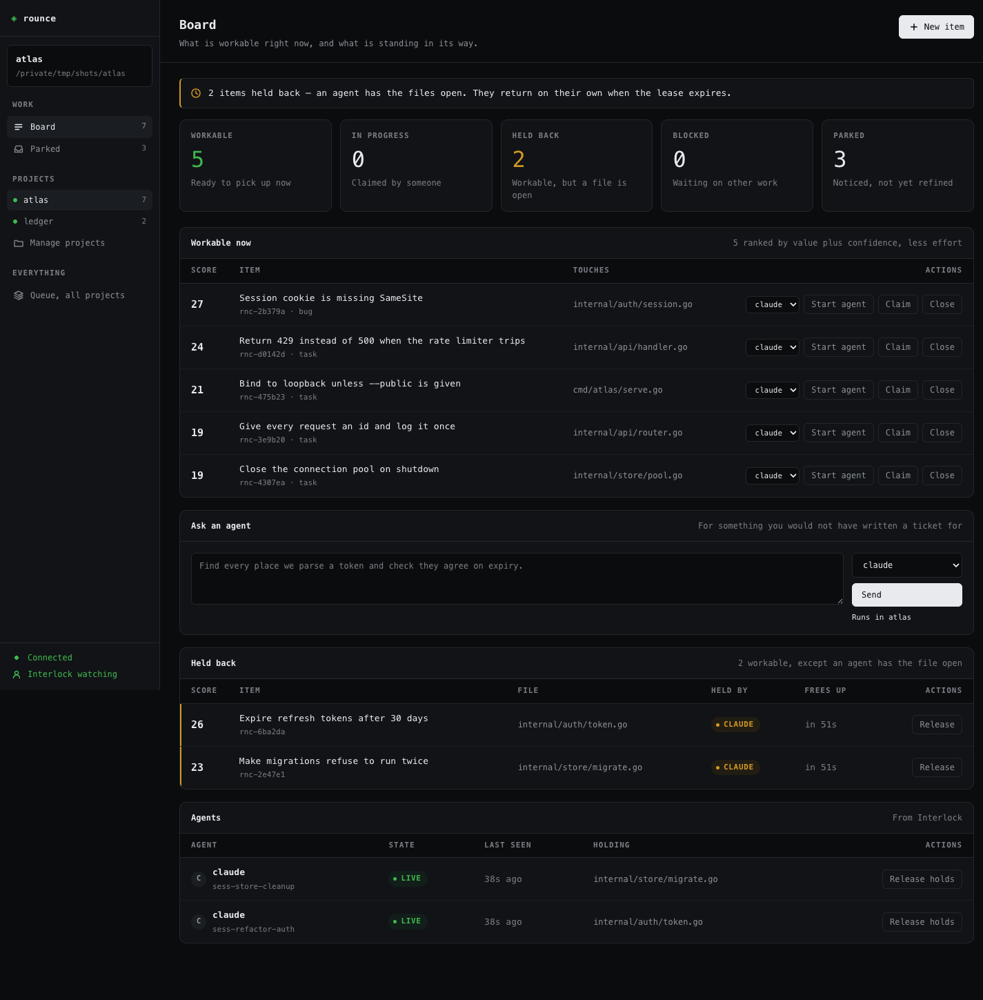
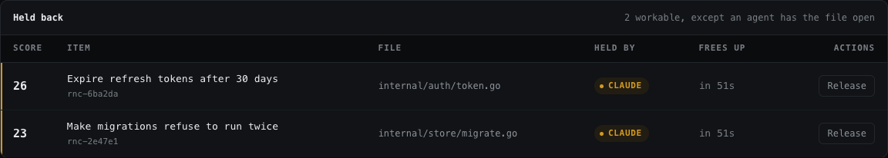
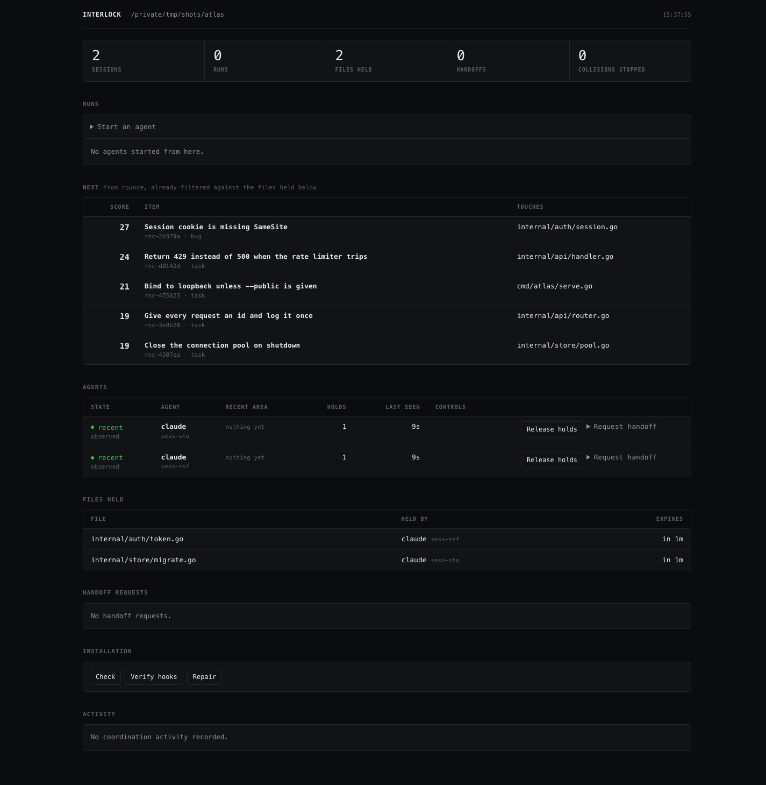

# Running rounce and Interlock together

rounce answers **what needs doing**. Interlock answers **who is doing what, and
where**. They are separate programs, neither imports the other, and either one
works alone. This is what happens when you install both.

---

## The problem they solve together

Open Claude Code in one terminal and Codex in another. Both ask for work. Both
get the same top-ranked ticket. Both start editing the same file.

rounce alone cannot prevent that — it does not watch processes. Interlock alone
cannot prevent it either — it stops the second write, but only after both agents
have already spent a while on the same task.

Together, the second agent never gets offered the work in the first place.

```
agent A                          agent B
   |                                |
   |-- rounce ready --------------->|  both see rnc-18da17 (28)
   |                                |
   |-- edits internal/auth/token.go |
   |     Interlock takes a lease    |
   |                                |
   |                                |-- rounce ready
   |                                |     rnc-18da17 is gone
   |                                |     rnc-d15cac (23) instead
```

Nothing coordinates the two agents. rounce simply stops offering work whose
files are spoken for.

---

## Install

Both are single Go binaries with no runtime services.

```bash
go install github.com/gshepptech/rounce/cmd/rounce@latest
go install github.com/gshepptech/interlock/cmd/interlock@latest

cd /your/repo
rounce init        # creates .rounce/db.sqlite
interlock init     # wires the agent hooks, merges, never replaces
```

Order does not matter. Neither `init` touches the other's state.

---

## Give the work paths

The join runs on one field: `paths`, on a rounce item.

```bash
rounce add --score 9/9/1 \
  --paths "internal/auth/token.go" \
  --why "tokens never expire; a leaked one is permanent" \
  "Expire refresh tokens after 30 days"
```

**Comma-separated, repo-relative.** An item with no paths is never held back —
rounce does not know what that work touches, and guessing that it collides would
hide workable tickets. Interlock's own hook still blocks the write if two agents
land on the same file anyway.

That is the failure direction on purpose: rounce would rather offer work
someone has quietly started than hide work nobody is doing.

---

## What each side does with the other

| | reads | over | when it is missing |
|---|---|---|---|
| `rounce ready` | Interlock's leases | `interlock status --json` | queue is unfiltered, no error |
| `interlock next` | rounce's queue | `rounce ready --json` | one sentence saying there is no work list |

Both directions are a subprocess and a versioned CLI contract, never a Go
import. That is what keeps "either works alone" true rather than aspirational:
a Go import would mean rounce stops building without Interlock.

An unrecognised version on either side filters nothing rather than guessing.

### Turning a direction off

```bash
ROUNCE_INTERLOCK=off    # rounce stops consulting Interlock
INTERLOCK_ROUNCE=off    # Interlock stops consulting rounce
```

Two variables, one per direction. Each can also be set to an absolute path if
the binary is not on `PATH`.

---

## Seeing it

One page shows both sides. rounce's board reads Interlock directly, so you do
not need to keep two dashboards open to answer one question.

```bash
rounce board --web        # the queue, who is holding it up, and the agents
interlock dashboard       # the same moment from the territory's side
```

### The board



Five panels, top to bottom: the counts, **Workable now**, **Ask an agent**,
**Held back**, and **Agents**. The last two only appear when Interlock is
installed and wired — with it off, the board is the queue and nothing else, and
says so in the sidebar.

**Held back** is the join made visible:



Two items are workable on their own merits and absent from the queue above.
The panel names the file, the agent, and when the lease frees up. The queue and
this panel come from one store call, so the board can never drop an item it
fails to explain.

**Release** hands a file back early. It is the one destructive control on the
page, and it does what Interlock's own `lease release` does — nothing rounce
invented.

### Interlock — the panel



The same moment from the other side. **Next** is rounce's queue, already
filtered; **Files held** below is why the two higher-scoring items are not in
it.

---

## Starting an agent from the board

Every workable row carries a runner picker and **Start agent**. Pressing it
runs, in the project's own directory:

```bash
interlock run <agent> --item <id> --no-follow -- "<the item's title and reason>"
```

Interlock owns the process from there: it supervises the run, its hooks fire,
and the agent claims files as it writes them. rounce does not spawn agents
itself and does not want to — a second supervisor is a second thing to be
wrong.

**Ask an agent**, below the queue, is the same path without an item, for work
you would not have written a ticket for. Both report what actually happened: a
run that fails on startup — no credentials, no such runner — is reported as a
failure with Interlock's own reason, not as a successful launch.

To watch a run, or stop one:

```bash
interlock runs list
interlock runs logs <run-id>
interlock runs stop <run-id>
```

---

## Several projects at once

`rounce init` registers a repository, so the board's sidebar lists every project
you have initialised and each keeps its own store, queue and board. **Manage
projects** adds one you have cloned since, or forgets one — forgetting removes
it from the list and never touches the store.

Interlock is per-repository too, and the board says which project it is looking
at, by name and by full path, at the top of the sidebar. The status line at the
bottom says whether Interlock is watching *that* project. Switching projects
switches both.

**Queue, all projects** pools every registered project into one ranked list, for
the morning question of what to work on before you have decided where.

---

## What this does not do

- **It does not assign work by itself.** rounce holds the list and Interlock
  holds the territory. Nothing starts unless you ask — pressing **Start agent**
  is you asking, and so is `interlock run`. Neither program decides on its own
  that an item should be worked on.
- **It does not make the queue safe to race on.** A lease appears when an agent
  writes, not when it starts thinking. Two agents that both ask within the same
  second can still both be offered the same item.
- **It does not survive a missing `paths`.** Work you want protected has to say
  what it touches.

---

## Checking it works

```bash
rounce ready                 # note the top item
# ...let an agent start editing one of its files...
rounce ready                 # the item is gone; stderr names the holder
interlock status --json      # the lease that caused it
```

`rounce ready` writes the queue to stdout and the explanation to stderr, so a
script piping the queue never has to strip prose.
